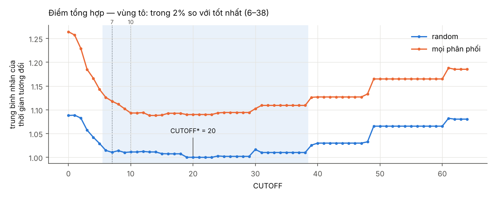
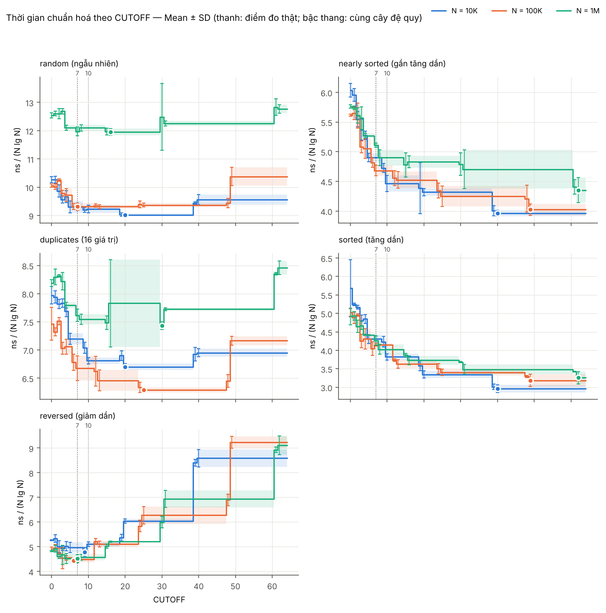

# MergeSort Cutoff Lab

Thí nghiệm tìm ngưỡng **CUTOFF** để top-down mergesort chuyển sang insertion sort trên đoạn nhỏ, trên chính cấu hình
máy của người đo. Giáo trình (Sedgewick & Wayne, *Algorithms 4th ed.*, §2.2) nhắc CUTOFF = 7 (bản cũ) và 10 (bản mới);
project này **đo** để biết giá trị nào phù hợp, theo phương pháp thực nghiệm của chủ đề 1.3 *Analysis of Algorithms*.

- Đo bằng **JMH**; mỗi cấu hình (dataset, CUTOFF) chạy trong các **JVM fork riêng**, thứ tự xáo trộn ngẫu nhiên.
- **51 bộ dữ liệu** (N = 10⁴, 10⁵, 10⁶; 5 kiểu phân bố) sinh xác định từ seed, có SHA-256.
- **CUTOFF 0–64**, gộp các CUTOFF cho cùng cây đệ quy để chỉ đo 646 thay vì 3.315 cấu hình.
- Thống kê phân cấp, CI 95 %, bootstrap, so sánh cặp; đếm chính xác số phép so sánh; doubling test.

📄 **Báo cáo:** [`report/REPORT.md`](report/REPORT.md) · 📊 **Bảng và hình:** [`results/analysis-grid-20261109-095145/README.md`](results/analysis-grid-20261109-095145/README.md) · 🗂 **Các lượt chạy:** [`results/README.md`](results/README.md)

## Mục lục

1. [Kết quả chính](#1-kết-quả-chính)
2. [Quy trình thí nghiệm](#2-quy-trình-thí-nghiệm)
3. [Cấu trúc repo và mã nguồn](#3-cấu-trúc-repo-và-mã-nguồn)
4. [Hướng dẫn chạy](#4-hướng-dẫn-chạy)
5. [File cấu hình](#5-file-cấu-hình)
6. [Kết quả đầu ra](#6-kết-quả-đầu-ra)
7. [Xử lý lỗi thường gặp](#7-xử-lý-lỗi-thường-gặp)
8. [Ghi chú](#8-ghi-chú)

## 1. Kết quả chính

Máy đo: Intel Core i5-11400H (6 nhân, L3 12 MB), Windows 11, Microsoft OpenJDK 25.0.1, JMH 1.37.

| | Kết quả |
|---|---|
| CUTOFF tốt nhất (dữ liệu ngẫu nhiên) | **20**; mọi CUTOFF trong **6–38** chậm hơn tối ưu ≤ 2 % |
| CUTOFF 7 / 10 của giáo trình | chậm hơn ≈ 1,1 %, không đáng kể trong thực tế |
| So với mergesort gốc | nhanh hơn **8,8 %** (random, 15/15 dataset, p ≈ 3·10⁻⁷), **16 %** trên mọi phân bố |
| Theo phân bố | gần sắp xếp: CUTOFF ≥ 40–62 · giảm dần: 6–9 · nhiều khoá trùng: 20–30 |
| Doubling test | khớp N lg N khi dữ liệu vừa cache (b ≈ 1,10); cutoff không đổi bậc tăng |





Phân tích chi tiết (vì sao đường cong phẳng, hiện tượng bậc thang, số phép so sánh so với thời gian, ảnh hưởng
của cache) nằm ở [mục 6 của báo cáo](report/REPORT.md#6-phân-tích-và-đánh-giá).

## 2. Quy trình thí nghiệm


| Bước | Làm gì | Lượt đã báo cáo |
|---|---|---|
| Kiểm thử | đúng, ổn định, quy ước CUTOFF, số mảng phụ | `CheckSort` PASS 10.075 trường hợp |
| Pilot | 4 dataset × 5 CUTOFF, ghi cả vòng warm-up | [`pilot-20261109-093257`](results/pilot-20261109-093257) |
| Lưới chính | 51 dataset × CUTOFF 0–64 → 646 cấu hình, 2.346 JVM | [`grid-20261109-095145`](results/grid-20261109-095145) |
| Doubling | random, N = 2¹²…2²⁰, CUTOFF {0, 7, 10, 20} | [`doubling-20261109-112935`](results/doubling-20261109-112935) |

## 3. Cấu trúc repo và mã nguồn

```
mergesort-cutoff-lab/
├── src/main/java/study/      mã nguồn Java (bảng bên dưới)
├── configs/                  cấu hình pilot / lưới chính / doubling
├── scripts/                  build, chạy, phân tích (.ps1 Windows, .sh Linux/macOS)
├── data/manifest.csv         danh sách dataset + SHA-256 (file .bin được sinh lại)
├── results/                  số liệu gốc và phân tích của các lượt chạy cuối cùng
├── report/REPORT.md          báo cáo thí nghiệm
├── pom.xml                   Maven: JMH 1.37, đóng gói target/benchmarks.jar
└── requirements.txt          thư viện Python cho phân tích
```

### Thuật toán và kiểm thử

| File | Nội dung |
|---|---|
| [`sort/MergeSort.java`](src/main/java/study/sort/MergeSort.java) | **Cài đặt được đo.** Top-down mergesort ghép từ slide bài giảng: `merge()`, `sort()` đệ quy với nhánh `if (hi <= lo + cutoff - 1) insertionSort(...)`, `sort()` công khai cấp phát `aux` một lần. API: `sort(Comparable[] a, int cutoff)`. |
| [`check/CheckSort.java`](src/main/java/study/check/CheckSort.java) | Cổng kiểm thử trước khi đo: sắp xếp đúng, bảo toàn phần tử, ổn định (31 kích thước × 5 kiểu đầu vào × CUTOFF 0–64), mảng rỗng, CUTOFF âm, quy ước CUTOFF (qua chuỗi phép so sánh) và số mảng phụ được cấp phát (đo bằng `ThreadMXBean`). Chế độ `--require` thất bại nếu `MergeSort` còn là placeholder. |

### Dữ liệu

| File | Nội dung |
|---|---|
| [`data/Dataset.java`](src/main/java/study/data/Dataset.java) | Sinh 5 phân bố (`random`, `nearly_sorted`, `duplicates`, `sorted`, `reversed`) từ seed xác định; đọc/ghi file nhị phân (int32 big-endian: N rồi N giá trị); SHA-256; đọc `manifest.csv` và kiểm tra hash mỗi lần nạp. |
| [`data/GenerateData.java`](src/main/java/study/data/GenerateData.java) | Sinh toàn bộ dữ liệu: nhóm `sweep` (51 dataset) và nhóm `doubling` (N = 2¹²…2²⁰), ghi `data/manifest.csv`. |

### Đo thời gian

| File | Nội dung |
|---|---|
| [`Launcher.java`](src/main/java/study/Launcher.java) | Điều phối một lượt chạy từ file `.properties`: chọn dataset, tính lớp CUTOFF tương đương, xáo trộn thứ tự, ước tính thời gian (`--dry-run`), chạy từng cấu hình trong JVM riêng, ghi `schedule.csv`, `environment.txt`, JSON; hỗ trợ `--resume` và `--set key=value`. |
| [`jmh/SortBenchmark.java`](src/main/java/study/jmh/SortBenchmark.java) | Benchmark JMH `SingleShotTime`: trial setup nạp + boxing dataset, iteration setup clone mảng, `@Benchmark` gọi `MergeSort.sort`, teardown kiểm tra kết quả đã sắp xếp. |
| [`jmh/JmhBackend.java`](src/main/java/study/jmh/JmhBackend.java) | Chạy một cấu hình qua JMH `Runner` (số fork, warm-up, measurement, tham số JVM), xuất JSON. |
| [`bench/Backend.java`](src/main/java/study/bench/Backend.java) | Giao diện backend; `auto` chọn JMH nếu có trên classpath, ngược lại dùng backend fork. |
| [`bench/ForkBackend.java`](src/main/java/study/bench/ForkBackend.java), [`bench/ForkWorker.java`](src/main/java/study/bench/ForkWorker.java) | Backend dự phòng chỉ cần JDK: mỗi fork là một JVM con chạy `ForkWorker` với cùng giao thức như JMH; kết quả ghi ra JSON cùng định dạng JMH. |
| [`bench/BenchSupport.java`](src/main/java/study/bench/BenchSupport.java) | Tiện ích chung: boxing `Integer`, kiểm tra Integer cache, kiểm tra đã sắp xếp, phát hiện placeholder, SHA-256 của `MergeSort.class`. |

### Phân tích

| File | Nội dung |
|---|---|
| [`analysis/CompareCounter.java`](src/main/java/study/analysis/CompareCounter.java) | Đếm chính xác số phép `compareTo` và băm chuỗi phép so sánh; tính các lớp CUTOFF tương đương từ cây đệ quy (`nodeLengths`) và kiểm chứng chúng trên cài đặt (`contractViolation`). |
| [`scripts/analyze.py`](scripts/analyze.py) | Đọc JSON JMH của một lượt chạy. Pilot: đường cong warm-up, độ lệch theo w, CV giữa fork. Lưới: gộp iteration → fork → dataset, điền các CUTOFF tương đương, Mean ± SD, CI 95 %, bootstrap phân cấp, CUTOFF\*, so sánh cặp (t-test, Wilcoxon), 6 hình, `README.md` của thư mục phân tích. Doubling: tỉ số T(2N)/T(N), khớp T(N) ≈ a·N^b trên hai khoảng N. |
| [`util/Cli.java`](src/main/java/study/util/Cli.java) | Đọc tham số dòng lệnh `--key value` và danh sách dạng `0-10,12,15`. |

### Script

| File | Nội dung |
|---|---|
| [`scripts/build.ps1`](scripts/build.ps1) · [`build.sh`](scripts/build.sh) | Build bằng Maven (hoặc JDK thuần với `-NoMaven` / `--no-maven`), kiểm tra JMH nhận benchmark, chạy `CheckSort`. |
| [`scripts/pilot.ps1`](scripts/pilot.ps1) · [`pilot.sh`](scripts/pilot.sh) | Build + kiểm thử bắt buộc, sinh dữ liệu nếu thiếu, chạy pilot, phân tích. |
| [`scripts/run.ps1`](scripts/run.ps1) · [`run.sh`](scripts/run.sh) | Build + kiểm thử bắt buộc rồi chạy `Launcher` với một file cấu hình (`-DryRun`, `-Resume`). |
| [`scripts/analyze.ps1`](scripts/analyze.ps1) · [`analyze.sh`](scripts/analyze.sh) | Gọi `analyze.py` bằng Python trong `.venv` (hoặc Python của hệ thống). |

## 4. Hướng dẫn chạy

### Yêu cầu

- JDK 17+ (đã dùng Microsoft OpenJDK 25.0.1)
- Maven 3.9: không bắt buộc (có backend dự phòng chỉ cần JDK)
- Python 3.10+ **bản chính thức từ python.org** (không dùng Python của MSYS2)

### Windows (PowerShell, tại thư mục gốc repo)

```powershell
# 0. Cho phép chạy script tải từ mạng (chỉ trong cửa sổ hiện tại)
Get-ChildItem -Recurse | Unblock-File
Set-ExecutionPolicy -Scope Process -ExecutionPolicy Bypass

# 1. Build + kiểm thử bắt buộc
./scripts/build.ps1 -RequireImplementation

# 2. Sinh dữ liệu (60 file, ~84 MB; trùng SHA-256 với data/manifest.csv)
java -cp target/benchmarks.jar study.data.GenerateData

# 3. Môi trường Python
py -3 -m venv .venv
./.venv/Scripts/python.exe -m pip install -r requirements.txt

# 4. Pilot chọn warm-up (~5 phút) -> xem results/analysis-pilot-*/README.md
./scripts/pilot.ps1 -Warmup 20 -Measurements 10 -Forks 3

# 5. Lưới chính: xem trước quy mô, rồi chạy thật (~1,5 giờ trên i5-11400H)
./scripts/run.ps1 configs/grid.properties -DryRun
./scripts/run.ps1 configs/grid.properties

# 6. Phân tích lưới chính (ghi results/best_cutoff.txt)
./scripts/analyze.ps1 results/grid-<thời gian>

# 7. Doubling test (~5 phút) và phân tích gộp
./scripts/run.ps1 configs/doubling.properties
./scripts/analyze.ps1 results/grid-<thời gian> --doubling results/doubling-<thời gian>
```

Lượt chạy bị ngắt: `./scripts/run.ps1 -Resume results/grid-<thời gian>` (bỏ qua các cấu hình đã xong; từ chối nếu
`MergeSort` đã bị sửa). Không có Maven: thêm `-NoMaven` vào `build.ps1`, `pilot.ps1`, `run.ps1`.

### Linux / macOS

```bash
./scripts/build.sh --require
java -cp target/benchmarks.jar study.data.GenerateData
python3 -m venv .venv && .venv/bin/python -m pip install -r requirements.txt
./scripts/pilot.sh 20 10 3
./scripts/run.sh configs/grid.properties --dry-run
./scripts/run.sh configs/grid.properties
./scripts/analyze.sh results/grid-<thời gian>
./scripts/run.sh configs/doubling.properties
./scripts/analyze.sh results/grid-<thời gian> --doubling results/doubling-<thời gian>
```

Không có Maven: `NO_MAVEN=1 ./scripts/run.sh ...`. Tiếp tục lượt bị ngắt: `./scripts/run.sh --resume results/grid-<thời gian>`.

### Điều kiện đo

Cắm sạc, chế độ nguồn hiệu năng cao, tắt Sleep và Windows Update, đóng mọi ứng dụng (kể cả IDE và trình duyệt),
**không dùng máy trong lúc đo**. Dùng máy giữa chừng có thể làm CV giữa các fork tăng từ ~2 % lên ~15 %
(xem [mục 7 của báo cáo](report/REPORT.md#7-độ-tin-cậy-và-hạn-chế)).

## 5. File cấu hình

[`configs/grid.properties`](configs/grid.properties), [`configs/pilot.properties`](configs/pilot.properties),
[`configs/doubling.properties`](configs/doubling.properties): đúng cấu hình của các lượt đã báo cáo.

| Khoá | Ý nghĩa |
|---|---|
| `mode` | `pilot` (ghi cả vòng warm-up), `grid`, `doubling` |
| `backend` | `auto` (JMH nếu có), `jmh`, `fork` |
| `group`, `dists`, `sizes`, `seeds`, `datasets` | chọn dataset theo nhóm / phân bố / N / seed, hoặc liệt kê id |
| `cutoffs` | danh sách hoặc khoảng, ví dụ `0-64` hay `0,7,10,best` (`best` lấy từ `bestFile`) |
| `dedupe` | chỉ đo một CUTOFF mỗi lớp tương đương (cùng cây đệ quy) |
| `controls` | các CUTOFF luôn đo riêng; `0,1` dùng làm đối chứng nhiễu |
| `warmup`, `measurements`, `forks` | mặc định cho mọi N; ghi đè theo N bằng `warmup.10000=100`, … |
| `orderSeed` | seed xáo trộn thứ tự cấu hình |
| `jvmArgs` | tham số JVM của mỗi fork (`-Xms2g -Xmx2g -XX:+UseParallelGC`) |

Mọi khoá có thể ghi đè khi chạy: `java -cp target/benchmarks.jar study.Launcher configs/grid.properties --set forks=5`.

## 6. Kết quả đầu ra

Mỗi lượt chạy tạo `results/<mode>-<thời gian>/`:

| File | Nội dung |
|---|---|
| `README.md` | tóm tắt lượt chạy (chế độ, quy mô, cấu hình đo) và mục lục các file, GitHub hiển thị khi mở thư mục |
| `config.properties` | cấu hình hiệu lực (kể cả backend, danh sách CUTOFF) |
| `environment.txt` | JDK, OS, CPU, tham số JVM, SHA-256 của `MergeSort.class` |
| `manifest.csv` | bản sao manifest dữ liệu đã dùng |
| `compares.csv`, `equivalence.csv` | số phép so sánh; lớp CUTOFF tương đương theo N |
| `schedule.csv` | thứ tự chạy, trạng thái, thời gian từng cấu hình |
| `jmh/*.json` | số liệu gốc định dạng JMH, mỗi cấu hình một file |
| `logs/*.log` | log của từng cấu hình |

`analyze.py` ghi vào `results/analysis-<lượt>/`: `raw.csv`, `forks.csv`, `datasets.csv`, `summary.csv`,
`best_by_config.csv`, `overall_score.csv`, `paired.csv`, `figures/*.png` và `README.md` (bảng + hình, tiếng Việt).

## 7. Xử lý lỗi thường gặp

| Hiện tượng | Cách xử lý |
|---|---|
| `mvn` không được nhận diện | cài Maven (giải nén bản zip, thêm thư mục `bin` vào PATH) hoặc dùng `-NoMaven` |
| `running scripts is disabled on this system` | `Unblock-File` và `Set-ExecutionPolicy -Scope Process Bypass` (mục 4) |
| `SCAFFOLD ONLY` / `MergeSort is still TODO` | `MergeSort.java` chưa được cài đặt |
| `FAIL (cutoff convention)` | kiểm tra `hi - lo + 1 <= cutoff` và `mid = lo + (hi - lo) / 2` |
| `WARN: ... allocated ~k arrays` | mảng phụ đang được cấp phát trong đệ quy hoặc trong `merge` |
| pip build numpy từ source (`Ninja or make is required`) | `python` trỏ tới Python của MSYS2; tạo venv bằng `py -3` |
| `No module named numpy` | chưa cài thư viện vào `.venv` (mục 4, bước 3) |
| `SHA-256 mismatch` | dữ liệu đã bị sửa, sinh lại bằng `GenerateData` |
| `MergeSort changed since this run started` | không resume trộn hai cài đặt; bắt đầu lượt mới |
| CV giữa các fork lớn trong pilot | máy đang bận hoặc nóng; đóng ứng dụng rồi chạy lại pilot |
| `WARNING: sun.misc.Unsafe ...` | cảnh báo của Maven/JMH trên JDK mới, vô hại |

## 8. Ghi chú

- `MergeSort` được ghép từ code trên slide bài giảng (Merge và "practical improvements"); không dùng cài đặt khác.
  Cải tiến "bỏ qua merge khi hai nửa đã có thứ tự" không dùng, để thí nghiệm chỉ thay đổi CUTOFF.
- Harness đo, bộ sinh dữ liệu, kiểm thử, script phân tích và bản nháp báo cáo được viết với sự hỗ trợ của AI (Claude),
  trong phạm vi đề bài cho phép.
- Đưa lên GitHub từ Windows: sau `git add .`, chạy
  `git update-index --chmod=+x scripts/build.sh scripts/pilot.sh scripts/run.sh scripts/analyze.sh`
  để giữ quyền thực thi của các script `.sh`.
# MergeSort-Cutoff-Project

