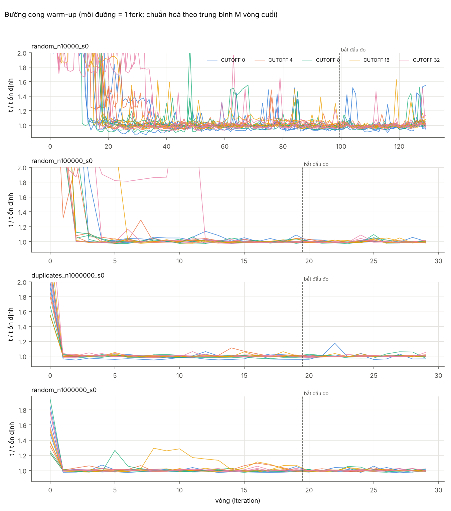
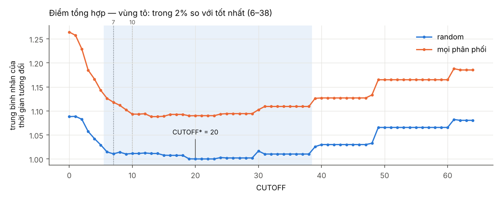
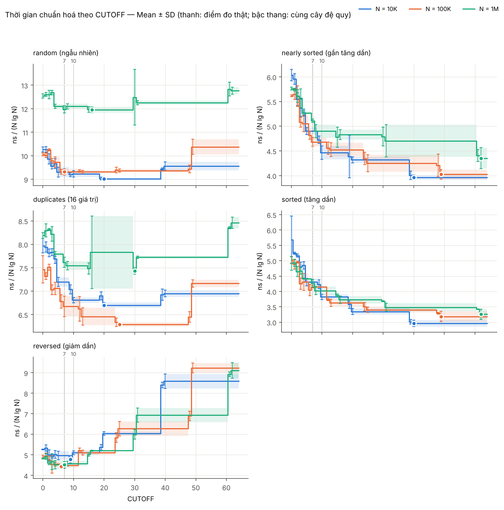
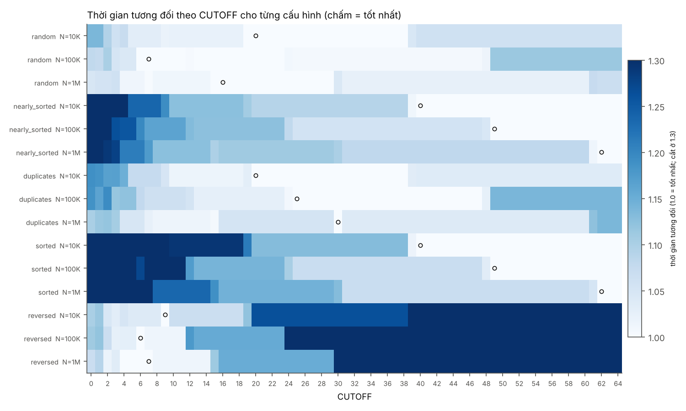
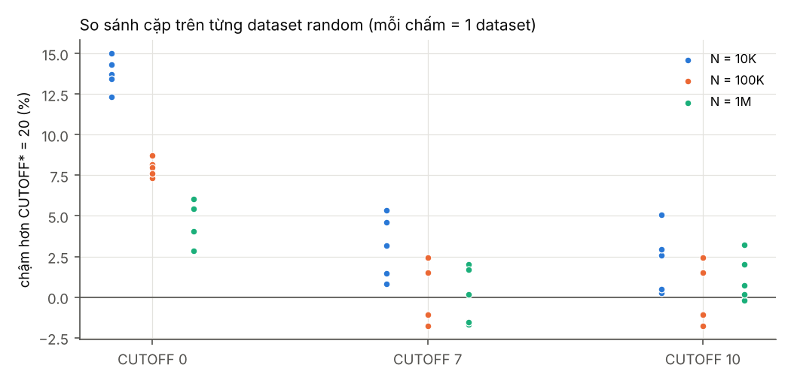
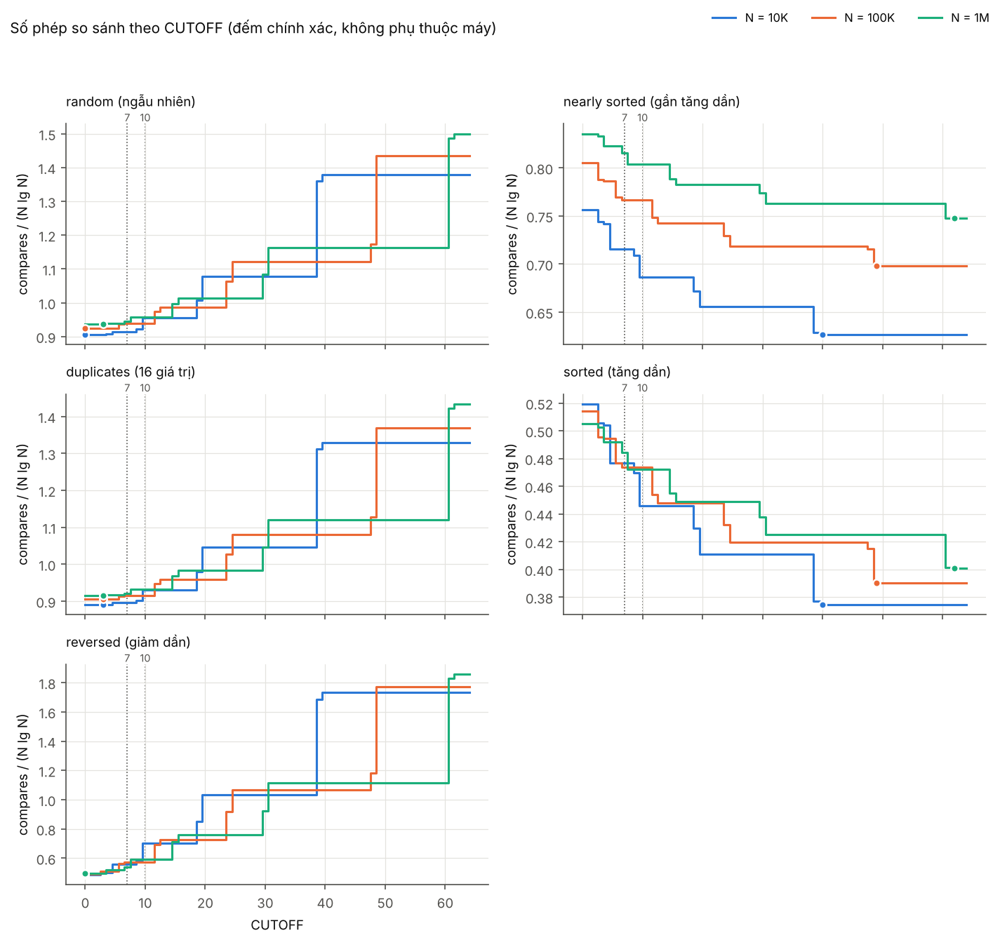
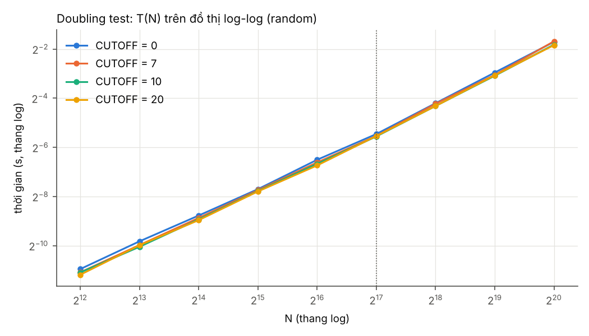

# BÁO CÁO THÍ NGHIỆM: TÌM GIÁ TRỊ CUTOFF PHÙ HỢP CHO MERGESORT

**Họ tên:** Nguễn Anh Tuấn. 
**MSSV:** 25021991. 
**Lớp học phần:** 2627I_UET.CS1058_9.


---

## Tóm tắt

Thí nghiệm đo thời gian top-down mergesort (cài đặt theo slide bài giảng) với CUTOFF từ 0 đến 64 trên
51 bộ dữ liệu (N = 10⁴, 10⁵, 10⁶; 5 kiểu phân bố), bằng JMH với mỗi cấu hình chạy trong JVM riêng, trên máy
Intel Core i5-11400H. Kết quả chính:

- **CUTOFF tốt nhất trên máy này là 20** (dữ liệu ngẫu nhiên), nhưng đường cong rất phẳng: mọi CUTOFF trong
  **6–38** chỉ chậm hơn tối ưu không quá 2 %.
- CUTOFF **7 và 10** của giáo trình chỉ chậm hơn ≈ 1,1 %, khác biệt không có ý nghĩa thực tế
  (với 7 cũng không có ý nghĩa thống kê).
- So với mergesort gốc, cutoff nhanh hơn **8,8 %** trên dữ liệu ngẫu nhiên (15/15 bộ dữ liệu, p ≈ 3·10⁻⁷) và
  **16 %** tính trên mọi phân bố; lợi ích giảm dần khi N tăng.
- Kiểu dữ liệu chi phối mạnh: dữ liệu gần sắp xếp ưa CUTOFF lớn (≥ 62), dữ liệu giảm dần ưa CUTOFF nhỏ (6–9).
- Doubling test: thời gian khớp N lg N khi dữ liệu nằm gọn trong cache; cutoff không đổi bậc tăng.

---

## 1. Mục tiêu và câu hỏi

Mergesort và Quicksort có chung cải tiến: khi đoạn con đủ nhỏ (độ dài ≤ CUTOFF) thì chuyển sang insertion sort.
Giáo trình nhắc CUTOFF = 7 (bản cũ) và 10 (bản mới). Thí nghiệm trả lời:

- **Q1.** Trên máy của tôi, CUTOFF nào cho thời gian sắp xếp nhỏ nhất?
- **Q2.** CUTOFF tốt nhất có phụ thuộc kích thước N và phân bố đầu vào không?
- **Q3.** Chênh lệch giữa CUTOFF tốt nhất với 7, 10 và với mergesort gốc có ý nghĩa thống kê và thực tế không?

**Giả thuyết ban đầu** (từ giáo trình): tối ưu nằm quanh 7–15; cutoff giúp nhanh hơn khoảng 10–15 % (sách, §2.2);
đường cong khá phẳng quanh tối ưu.

## 2. Cơ sở lý thuyết

**Vì sao cutoff giúp nhanh hơn.** Với đoạn rất nhỏ, chi phí cố định của mergesort (lời gọi đệ quy, tính `mid`,
copy sang `aux`, các nhánh trong `merge`) lớn so với công việc thực sự; insertion sort trên đoạn nhỏ có vòng lặp
đơn giản, dữ liệu nằm gọn trong cache, không dùng mảng phụ.

**Mô hình chi phí.** Gọi L là độ dài trung bình của "lá" (đoạn giao cho insertion sort):

- merge: ≈ lg(N/L) tầng, mỗi tầng xử lý N phần tử → α · N · lg(N/L);
- insertion sort trên đoạn ngẫu nhiên độ dài L: ≈ L²/4 bước, có N/L đoạn → β · N · L/4.

T(L) ≈ N [α lg(N/L) + β L/4] ⇒ đạo hàm bằng 0 tại **L\* = 4α / (β ln 2) ≈ 5,8 · α/β**.

- Nếu chỉ đếm phép so sánh (α = β): L\* ≈ 5,8, số phép so sánh nhỏ nhất ở CUTOFF nhỏ.
- Về thời gian, một bước merge (đọc `aux`, so sánh, ghi `a`, kiểm tra biên) đắt hơn một bước insertion sort
  (α > β) ⇒ L\* lớn hơn. L\* không phụ thuộc N ⇒ cutoff chỉ đổi hằng số, không đổi bậc N lg N.
- Quanh cực tiểu, T(L) thay đổi chậm (hàm lg cộng hàm tuyến tính) ⇒ dự đoán một **vùng tối ưu phẳng**.

**Hiện tượng bậc thang.** Top-down mergesort chỉ tạo các đoạn con dài ≈ N/2ᵏ, nên mọi CUTOFF nằm giữa hai độ dài
liên tiếp sinh ra **cùng một cây đệ quy**: cùng công việc, không thể phân biệt bằng đo. Thí nghiệm tính chính xác
các lớp tương đương này, kiểm chứng trên cài đặt bằng chuỗi phép so sánh, chỉ đo một đại diện mỗi lớp, và dùng
3 giá trị N (10⁴, 10⁵, 10⁶) để các "bậc" của chúng xen kẽ nhau.

## 3. Cài đặt

Top-down mergesort ghép từ slide bài giảng: `merge()` và `sort()` công khai từ slide *Mergesort: Java
implementation*, phần cutoff từ slide *Mergesort: practical improvements*. API dùng trong thí nghiệm:
`study.sort.MergeSort.sort(Comparable[] a, int cutoff)`.

```java
private static void sort(Comparable[] a, Comparable[] aux, int lo, int hi, int cutoff) {
    if (hi <= lo + cutoff - 1) {          // đoạn dài hi-lo+1 <= cutoff -> insertion sort (slide)
        insertionSort(a, lo, hi);
        return;
    }
    if (hi <= lo) return;                 // base case của bản gốc, cần khi cutoff = 0
    int mid = lo + (hi - lo) / 2;
    sort(a, aux, lo, mid, cutoff);
    sort(a, aux, mid + 1, hi, cutoff);
    merge(a, aux, lo, mid, hi);
}
```

- `cutoff = 0`: mergesort gốc; `cutoff < 0`: `IllegalArgumentException`; mảng rỗng/1 phần tử trả về ngay.
- Mảng `aux` cấp phát **một lần** trong `sort` công khai (đúng lưu ý của bài giảng).
- `merge` lấy phần tử bên trái khi hai khoá bằng nhau ⇒ ổn định; insertion sort dùng `less` chặt ⇒ ổn định.
- Cải tiến "bỏ qua merge khi hai nửa đã có thứ tự" **không** dùng, để thí nghiệm chỉ thay đổi CUTOFF.

**Kiểm thử** (`study.check.CheckSort`, PASS): 10.075 trường hợp (31 kích thước × 5 kiểu đầu vào × CUTOFF 0–64)
kiểm tra sắp xếp đúng, bảo toàn phần tử, ổn định; mảng rỗng; CUTOFF âm; quy ước CUTOFF (các CUTOFF cùng cây đệ quy
phải cho cùng chuỗi phép so sánh); mỗi lần `sort` cấp phát ≈ 1,00 mảng phụ.

## 4. Thiết kế thí nghiệm

| Yếu tố | Giá trị |
|---|---|
| Biến độc lập | CUTOFF ∈ {0, 1, …, 64} |
| Biến phụ thuộc | thời gian một lần sort (ns, JMH `SingleShotTime`); số phép so sánh (đếm chính xác) |
| Dữ liệu | 51 datasets: N ∈ {10⁴, 10⁵, 10⁶} × {random, nearly sorted, duplicates} × 5 seed + {sorted, reversed} |
| Phần tử | `Integer`; khoá trùng = 1.000.000 + nextInt(16) để không dùng chung object của Integer cache |
| Lặp | N = 10⁵, 10⁶: 20 vòng warm-up, 10 vòng đo, 3 JVM fork; N = 10⁴: 100 / 30 / 5 (chọn bằng pilot, mục 4.2) |
| Thứ tự | 646 cấu hình (dataset, CUTOFF đại diện) được xáo trộn theo seed 20261103 |
| Kiểm soát nhiễu | JVM riêng mỗi cấu hình; heap cố định 2 GB, ParallelGC; clone/kiểm tra kết quả không tính giờ; CUTOFF 0 và 1 luôn đo riêng làm đối chứng |
| Quy mô | 2.346 JVM, 43.860 lần sort được ghi nhận, ≈ 1,25 giờ máy |

### 4.1 Môi trường

| Mục | Giá trị |
|---|---|
| CPU | Intel Core i5-11400H (Tiger Lake-H), 6 nhân / 12 luồng, 2,7 GHz, Turbo tới 4,5 GHz |
| Cache | L2 1,25 MB mỗi nhân (7,5 MB tổng), L3 12 MB dùng chung |
| Hệ điều hành | Windows 11 (10.0, amd64) |
| JDK | Microsoft OpenJDK 25.0.1, 64-Bit Server VM |
| Công cụ đo | JMH 1.37 qua Maven; tham số JVM của fork: `-Xms2g -Xmx2g -XX:+UseParallelGC` |
| Điều kiện | cắm sạc, chế độ nguồn hiệu năng cao, không chạy ứng dụng khác, không dùng máy khi đo |

### 4.2 Pilot chọn warm-up

Pilot ghi lại **mọi** vòng (kể cả warm-up) trên 4 datasets × 5 CUTOFF. Với mỗi fork, độ lệch của trung bình
M vòng bắt đầu từ vòng w so với cửa sổ đo (sau W vòng warm-up):

| N | W thử | w = 5 | w = 15 | w = 50 | w = 75 | CV giữa fork |
|---|---|---|---|---|---|---|
| 10⁴ | 100 | 133 % (TB) | 24 % | 2,2 % | 1,6 % (max 5,7 %) | ≤ 6,1 % |
| 10⁵ | 20 | 7,5 % | 0,5 % (max 1,0 %) | – | – | ≤ 2,6 % |
| 10⁶ | 20 | 1,2 % | 0,6 % (max 2,6 %) | – | – | ≤ 2,6 % (random), ≤ 5,3 % (duplicates) |

Xu hướng trong cửa sổ đo nằm trong ±0,2 %/vòng. Vì vậy chọn W = 100 cho N = 10⁴ (mỗi lần sort chỉ ≈ 1,2 ms nên
JIT cần nhiều vòng, và đo một lần ngắn nhiễu hơn, bù bằng 30 vòng đo, 5 fork) và W = 20 cho N = 10⁵, 10⁶.



### 4.3 Thống kê

Gộp phân cấp: iteration → trung bình fork → trung bình dataset → (phân bố, N). Báo cáo Mean ± SD (SD giữa các
dataset; với sorted/reversed chỉ có một dataset nên là SD giữa các fork) và CI 95 %. Vị trí tối ưu được ước lượng
độ bất định bằng bootstrap phân cấp (lấy mẫu lại dataset rồi fork, 1.000 lần). So sánh hai CUTOFF dùng tỉ số trên
từng dataset (so sánh cặp): t-test trên log tỉ số và Wilcoxon signed-rank. **CUTOFF khuyến nghị** = CUTOFF có trung
bình nhân của thời gian tương đối (so với tốt nhất của từng N) nhỏ nhất trên các cấu hình random.

### 4.4 Dữ liệu

60 file nhị phân (51 cho lưới, 9 cho doubling) sinh xác định từ seed; `data/manifest.csv` lưu SHA-256 từng file và
mỗi lần đọc đều kiểm tra hash. Bộ dữ liệu đã được sinh lại trên một môi trường khác (Linux, OpenJDK 21) và trùng
SHA-256 cả 60/60 file ⇒ có thể tái tạo chính xác từ `study.data.GenerateData`.

## 5. Kết quả

Toàn bộ bảng và hình: [`results/analysis-grid-20261109-095145/README.md`](../results/analysis-grid-20261109-095145/README.md).

### 5.1 CUTOFF khuyến nghị



Thời gian tương đối được gộp bằng trung bình nhân trên các cấu hình (phân bố, N); mỗi cột so với tối ưu của chính cột đó.

| | Random (mọi N) | Mọi phân bố |
|---|---|---|
| CUTOFF tốt nhất | **20** | 13 |
| Vùng trong 2 % so với tốt nhất | **6–38** | 9–38 |
| CUTOFF 0 chậm hơn | +8,8 % | +16,2 % |
| CUTOFF 7 chậm hơn | +1,1 % | +2,8 % |
| CUTOFF 10 chậm hơn | +1,1 % | +0,5 % |
| CUTOFF 20 chậm hơn | – | +0,2 % |

### 5.2 Theo từng phân bố và N

`lớp tốt nhất` = các CUTOFF cho cùng cây đệ quy với CUTOFF tốt nhất; `rel_X` = thời gian của CUTOFF X / tốt nhất.

| Phân bố | N | lớp tốt nhất | vùng ≤ 2 % | bootstrap 95 % | rel_0 | rel_7 | rel_10 | t tốt nhất (ms) |
|---|---|---|---|---|---|---|---|---|
| random | 10⁴ | 20–38 | 9–38 | 19–20 | 1,138 | 1,031 | 1,022 | 1,199 |
| random | 10⁵ | 7–11 | 6–48 | 6–25 | 1,080 | 1,000 | 1,000 | 15,47 |
| random | 10⁶ | 16–29 | 4–29 | 7–30 | 1,049 | 1,001 | 1,012 | 238,4 |
| nearly sorted | 10⁴ | 40–64 | 39–64 | 39–40 | 1,523 | 1,237 | 1,126 | 0,526 |
| nearly sorted | 10⁵ | 49–64 | 49–64 | 25–49 | 1,395 | 1,164 | 1,164 | 6,684 |
| nearly sorted | 10⁶ | 62–64 | 61–64 | 61–62 | 1,324 | 1,175 | 1,126 | 86,75 |
| duplicates | 10⁴ | 20–38 | 10–38 | 20 | 1,190 | 1,074 | 1,016 | 0,890 |
| duplicates | 10⁵ | 25–47 | 24–47 | 13–25 | 1,187 | 1,061 | 1,061 | 10,45 |
| duplicates | 10⁶ | 30 | 8–30 | 15–30 | 1,101 | 1,024 | 1,015 | 148,2 |
| sorted | 10⁴ | 40–64 | 39–64 | 39–40 | 1,921 | 1,455 | 1,292 | 0,393 |
| sorted | 10⁵ | 49–64 | 49–64 | 48–49 | 1,578 | 1,305 | 1,305 | 5,286 |
| sorted | 10⁶ | 62–64 | 62–64 | 31–62 | 1,510 | 1,310 | 1,236 | 64,92 |
| reversed | 10⁴ | 9 | 9 | 3–9 | 1,101 | 1,039 | 1,067 | 0,636 |
| reversed | 10⁵ | 6 | 6–11 | 3–7 | 1,111 | 1,013 | 1,013 | 7,360 |
| reversed | 10⁶ | 7 | 2–14 | 3–7 | 1,069 | 1,000 | 1,013 | 90,08 |





### 5.3 So sánh cặp với CUTOFF\* = 20

Đơn vị so sánh là dataset (đã gộp fork); tỉ lệ > 1 nghĩa là chậm hơn CUTOFF 20.

| Nhóm | So sánh | Datasets | Tỉ lệ TB nhân | CI 95 % | Chậm hơn ở | p (t, log) | p (Wilcoxon) |
|---|---|---|---|---|---|---|---|
| random | 0 vs 20 | 15 | 1,088 | 1,067–1,110 | 15/15 | 3,0·10⁻⁷ | 6,1·10⁻⁵ |
| random | 7 vs 20 | 15 | 1,010 | 0,998–1,023 | 10/15 | 0,091 | 0,135 |
| random | 10 vs 20 | 15 | 1,011 | 1,001–1,022 | 11/15 | 0,035 | 0,041 |
| mọi phân bố | 0 vs 20 | 51 | 1,161 | 1,122–1,201 | 47/51 | 1,2·10⁻¹¹ | 1,1·10⁻⁸ |
| mọi phân bố | 7 vs 20 | 51 | 1,034 | 1,011–1,058 | 39/51 | 0,0047 | 0,0003 |
| mọi phân bố | 10 vs 20 | 51 | 1,011 | 0,994–1,029 | 36/51 | 0,21 | 0,0054 |
| reversed | 7 vs 20 | 3 | 0,856 | 0,785–0,933 | 0/3 | 0,016 | – |



### 5.4 Kiểm tra nhiễu (đối chứng CUTOFF 0 và 1)

CUTOFF 1 làm cùng công việc với CUTOFF 0 nên t(1)/t(0) lý tưởng bằng 1. Trên 51 dataset: trung vị **0,998**,
nhỏ nhất 0,906, lớn nhất 1,037 ⇒ phép đo không lệch hệ thống; độ nhiễu của **một** dataset có thể tới vài phần trăm,
nên kết luận dựa trên tổng hợp nhiều dataset chứ không dựa trên một điểm đo.

### 5.5 Số phép so sánh (không phụ thuộc máy)

Random, N = 10⁶:

| CUTOFF | 0 | 4 | 7 | 10 | 16–29 | 31–60 | 64 |
|---|---|---|---|---|---|---|---|
| Số phép so sánh (triệu) | 18,67 | 18,73 | 18,82 | 19,07 | 20,22 | 23,18 | 29,90 |
| So với CUTOFF 0 | 1,000 | 1,003 | 1,008 | 1,021 | 1,083 | 1,241 | 1,601 |

Số phép so sánh nhỏ nhất ở CUTOFF 3; tại CUTOFF\* = 20 nhiều hơn 8,3 % nhưng thời gian lại nhỏ nhất.



### 5.6 Doubling test (random, N = 2¹²…2²⁰)

| | 8K→16K | 16K→32K | 32K→64K | 64K→128K | 128K→256K | 256K→512K | 512K→1M |
|---|---|---|---|---|---|---|---|
| T(2N)/T(N), CUTOFF 0 | 2,07 | 2,10 | 2,29 | 2,07 | 2,38 | 2,38 | 2,38 |
| T(2N)/T(N), CUTOFF 10 | 2,17 | 2,22 | 2,16 | 2,17 | 2,36 | 2,34 | 2,41 |
| T(2N)/T(N), CUTOFF 20 | 2,03 | 2,25 | 2,08 | 2,29 | 2,33 | 2,38 | 2,34 |
| Lý thuyết N lg N: 2(1 + 1/lg N) | 2,15 | 2,14 | 2,13 | 2,13 | 2,12 | 2,11 | 2,11 |

Mô hình T(N) ≈ a·N^b:

| CUTOFF | b, N = 8K–128K | b, N = 128K–1M | b lý thuyết N lg N (hai khoảng) |
|---|---|---|---|
| 0 | 1,100 | 1,250 | 1,097 / 1,078 |
| 7 | 1,114 | 1,272 | |
| 10 | 1,124 | 1,244 | |
| 20 | 1,111 | 1,234 | |



## 6. Phân tích và đánh giá

### 6.1 CUTOFF tối ưu: một vùng phẳng, không phải một điểm (Q1)

CUTOFF\* = 20 cho dữ liệu ngẫu nhiên, nhưng vùng trong 2 % trải từ 6 đến 38 và khoảng bootstrap của vị trí tối ưu ở
N = 10⁵, 10⁶ rộng (6–25, 7–30). Nghĩa là thí nghiệm **không xác định được một giá trị tối ưu sắc nét**, điều này phù
hợp với mô hình chi phí (tổng của một hàm lg giảm và một hàm tuyến tính tăng thì phẳng quanh cực tiểu). Câu trả lời
trung thực cho Q1 là: *trên máy này, mọi CUTOFF trong khoảng 6–38 đều gần tối ưu; 20 là tốt nhất theo số đo*.

### 6.2 So với 7 và 10, và với mergesort gốc (Q3)

- **7 và 10 so với 20** (random): chậm hơn ≈ 1 %. Với 7, CI 95 % (0,998–1,023) chứa 1 ⇒ không khác biệt có ý nghĩa
  thống kê. Với 10, khác biệt có ý nghĩa thống kê ở mức yếu (p ≈ 0,04) nhưng chỉ 1,1 %, nhỏ hơn biên độ nhiễu của
  một lần đo đơn lẻ (mục 5.4), không có ý nghĩa thực tế. **Giá trị 10 của giáo trình là lựa chọn tốt trên máy này.**
- **So với mergesort gốc**: cutoff nhanh hơn 8,8 % trên random (15/15 dataset, p ≈ 3·10⁻⁷) và 16 % tính trên mọi phân
  bố. Mức trên random thấp hơn một chút so với 10–15 % mà sách nêu.
- **Lợi ích giảm khi N tăng**: rel_0 = 1,138 (10⁴) → 1,080 (10⁵) → 1,049 (10⁶). Cutoff chỉ tiết kiệm ở các tầng gần
  lá (một lượng ≈ c·N), trong khi số tầng merge tăng theo lg N; thêm vào đó, ở N lớn chi phí truy cập bộ nhớ của các
  tầng merge trên cùng (không bị cutoff ảnh hưởng) chiếm tỉ trọng lớn hơn.

### 6.3 Bậc thang và kích thước lá (Q2 theo N)

Với N cố định, chỉ có 12–13 lớp CUTOFF khác nhau trong 0–64 (ví dụ N = 10⁶: 0, 1, 2, 3, 4–6, 7, 8–14, 15, 16–29,
30, 31–60, 61, 62–64). Vì vậy "CUTOFF tốt nhất" ở từng N là một **lớp**, và đại lượng thực sự quyết định là
**độ dài lá**: lá trung bình ở lớp tốt nhất là ≈ 19,5 (10⁴), ≈ 6,1 (10⁵) và ≈ 15,3 (10⁶), tất cả nằm trong vùng
phẳng 6–20. Ví dụ rõ nhất ở doubling test: với N = 2²⁰ mọi đoạn con dài đúng 2ᵏ, nên CUTOFF 7 cho lá dài 4
(vì 8 > 7), CUTOFF 10 cho lá 8, CUTOFF 20 cho lá 16; do đó ở N = 2²⁰ CUTOFF 7 (310,6 ms) gần như không nhanh hơn
CUTOFF 0 (305,9 ms), trong khi CUTOFF 10 và 20 nhanh hơn ≈ 7–9 %. Hệ quả: một CUTOFF "tốt" phải được đánh giá trên
nhiều N, như thí nghiệm này làm, chứ không trên một N duy nhất.

### 6.4 Số phép so sánh khác thời gian: một bước merge đắt hơn một bước insertion sort

Số phép so sánh nhỏ nhất ở CUTOFF 3 (đúng dự đoán L\* ≈ 5,8 khi α = β), nhưng thời gian nhỏ nhất ở lá dài ≈ 6–20.
Theo mô hình L\* ≈ 5,8·α/β, điều đó tương ứng α/β ≈ 1–3,4: mỗi bước của merge (copy sang `aux`, so sánh, ghi lại,
kiểm tra hai biên, cộng chi phí đệ quy) đắt hơn một bước insertion sort (dịch chuyển kề nhau trong vùng nhớ vừa truy
cập). Mô hình rất thô (lá thực tế có độ dài không đều, hằng số bỏ qua), nên chỉ nên dùng để giải thích chiều hướng,
không để tính chính xác.

### 6.5 Phân bố đầu vào quyết định hướng tối ưu (Q2 theo phân bố)

- **sorted, nearly sorted**: tối ưu ở lớp lớn nhất (CUTOFF ≥ 40–62), CUTOFF 0 chậm hơn 32–92 %. Insertion sort chạy
  gần tuyến tính trên dữ liệu đã gần có thứ tự, nên giao càng nhiều việc cho nó càng lợi. Tối ưu nằm sát biên 64 của
  lưới ⇒ tối ưu thật với loại dữ liệu này có thể còn lớn hơn 64 (xem mục 7).
- **reversed**: tối ưu ở CUTOFF 6–9, trường hợp xấu nhất của insertion sort (≈ L²/2 bước mỗi lá); ở đây CUTOFF 7 và
  10 nhanh hơn 20 khoảng 13–14 %.
- **duplicates** (16 giá trị): tối ưu ở 20–30, gần với random nhưng hơi lớn hơn.
- Tính trên mọi phân bố, tối ưu dịch về **13** (vùng 2 %: 9–38); CUTOFF 10 chỉ chậm hơn 0,5 % và CUTOFF 20 chậm hơn 0,2 %. Vì phần lớn dữ liệu thực tế không
  biết trước phân bố, một giá trị trung dung trong khoảng **10–20** là lựa chọn an toàn.

### 6.6 Doubling test: N lg N cộng ảnh hưởng của bộ nhớ

Với N từ 8K đến 128K, tỉ số T(2N)/T(N) ≈ 2,03–2,29 và b ≈ 1,10–1,12, khớp với N lg N (lý thuyết 2,13–2,15 và
b ≈ 1,10). Từ N ≈ 256K, mọi CUTOFF cùng tăng nhanh hơn (tỉ số ≈ 2,25–2,6, b ≈ 1,23–1,27). Kích thước dữ liệu làm
việc khoảng 28 byte mỗi phần tử (object `Integer` 16 B + ba tham chiếu trong `a`, `aux` và mảng gốc): ≈ 3,7 MB ở
128K (vừa trong L3 12 MB), ≈ 7,3 MB ở 256K, ≈ 14,7 MB ở 512K (vượt L3) và ≈ 29 MB ở 1M. Các phép so sánh lại phải
đi theo tham chiếu tới object nằm rải rác trong heap, nên khi dữ liệu vượt cache, chi phí truy cập bộ nhớ tăng.
Cách giải thích này phù hợp với số liệu nhưng **chưa được chứng minh** (cần đo cache miss bằng profiler). Điều chắc
chắn hơn: độ dốc tăng như nhau ở mọi CUTOFF ⇒ **cutoff không đổi bậc tăng, chỉ đổi hằng số**.

### 6.7 Vì sao giáo trình đổi 7 → 10?

Số liệu cho thấy tối ưu (lá ≈ 6–20) lớn hơn điểm tối ưu theo số phép so sánh (≈ 3–6), tức là trên phần cứng hiện đại
một bước merge tương đối đắt hơn một bước insertion sort (α/β > 1). Bộ xử lý mới có pipeline sâu, dự đoán rẽ nhánh và
cache tốt, nên vòng lặp ngắn, truy cập liền kề của insertion sort ngày càng rẻ so với merge (nhiều nhánh, hai vùng nhớ,
copy sang `aux`) ⇒ CUTOFF tối ưu dịch lên. Đây là một suy luận phù hợp với số liệu, không phải điều thí nghiệm này
kiểm chứng trực tiếp (chỉ có một máy).

## 7. Độ tin cậy và hạn chế

- **Ảnh hưởng của việc dùng máy khi đo.** Pilot đầu tiên chạy trong lúc máy đang được dùng: CV giữa các fork tới
  14,9 % (N = 10⁶) và 49,6 % (N = 10⁴); lặp lại khi máy rảnh chỉ còn ≤ 2,6 % và 6,1 %. Lượt doubling đầu tiên vừa
  thiếu warm-up ở N = 4.096 (thời gian sai 2–4 lần) vừa bị dùng máy giữa chừng, nên đã đo lại với warm-up lớn hơn.
  Hai lượt này chỉ dùng để rút kinh nghiệm về điều kiện đo; repo chỉ lưu các lượt chạy cuối cùng.
- **Hai điểm đo bất thường trong lưới chính**: `random_n1000000_s4` ở CUTOFF 30 (290,8 ms so với ≈ 238 ms của 4 seed
  còn lại) và `duplicates_n1000000_s3` ở lớp 16–29 (183,2 ms so với ≈ 149 ms). Cả ba fork của mỗi cấu hình đều chậm
  ⇒ nhiều khả năng là nhiễu tạm thời của hệ thống. Chúng tạo các "gai" thấy được trong hình 1 và làm lớp 16–29 của
  duplicates 10⁶ trông kém hơn lớp 30 (bỏ điểm bất thường thì hai lớp ngang nhau ≈ 149 ms). Không loại bỏ hậu kiểm;
  CUTOFF\* tổng hợp không bị ảnh hưởng vì được tính trên 15 dataset random.
- **Biên của lưới**: với sorted/nearly sorted, tối ưu nằm ở lớp chứa CUTOFF 64 ⇒ chưa xác định được tối ưu thật cho
  loại dữ liệu này.
- **Một máy, một JDK**: kết quả là của i5-11400H + OpenJDK 25 (đúng yêu cầu đề bài); máy khác có thể cho CUTOFF\* khác.
- **Turbo Boost và nhiệt độ**: xung CPU thay đổi theo nhiệt; giảm ảnh hưởng bằng thứ tự xáo trộn, nhiều fork và nhiều
  dataset. Thời gian tuyệt đối giữa các lượt chạy có thể lệch ≈ 10 % (ví dụ N = 2²⁰ trong doubling so với N = 10⁶ trong
  lưới), nên chỉ so sánh tương đối trong cùng một lượt.
- **CUTOFF là tham số runtime** (không phải hằng `static final` như trên slide); JIT có thể tối ưu hằng số khác đôi chút.
- **Kiểu phần tử `Integer`** (truy cập qua tham chiếu); với `int[]` nguyên thuỷ hoặc `String` tối ưu có thể khác.
- **Lớp tương đương** dựa trên quy ước cài đặt, đã được kiểm chứng trên chính cài đặt bằng chuỗi phép so sánh;
  CUTOFF trong cùng lớp chỉ được đo một lần và dùng chung số liệu.

## 8. Kết luận

Trên máy Intel Core i5-11400H với OpenJDK 25, CUTOFF tốt nhất cho mergesort là **20** với dữ liệu ngẫu nhiên, nhưng
mọi giá trị từ **6 đến 38** chỉ chậm hơn tối ưu không quá 2 %; giá trị 7 và 10 của giáo trình chỉ chậm hơn ≈ 1 %,
không đáng kể trong thực tế. Cutoff giúp mergesort nhanh hơn 8,8 % trên dữ liệu ngẫu nhiên và 16 % trên mọi phân bố,
nhưng không thay đổi bậc tăng N lg N. Yếu tố quyết định là độ dài lá (≈ 6–20 phần tử) và phân bố đầu vào: dữ liệu gần
sắp xếp ưa CUTOFF lớn, dữ liệu giảm dần ưa CUTOFF nhỏ. **Khuyến nghị: dùng CUTOFF trong khoảng 10–20 trên máy này**;
giữ 10 như giáo trình là hợp lý, tăng lên 15–20 cho lợi ích nhỏ thêm với dữ liệu ngẫu nhiên.

## Phụ lục

**A. Tái lập.** Xem `README.md` (build → sinh dữ liệu → pilot → lưới chính → phân tích → doubling). Các lượt chạy:
`results/pilot-20261109-093257`, `results/grid-20261109-095145`, `results/doubling-20261109-112935`; SHA-256 của
`MergeSort.class`: `53f5e31b54fecf61…` (đầy đủ trong `environment.txt` của từng lượt). Phân tích được sinh lại bằng:

```powershell
.\scripts\analyze.ps1 results\grid-20261109-095145 --doubling results\doubling-20261109-112935
```

**B. Sử dụng AI** (đề bài cho phép dùng AI để thảo luận, viết script chạy thí nghiệm, xây dựng bộ dữ liệu test):
Harness đo (Launcher, backend JMH/fork), bộ sinh dữ liệu, `CheckSort`, script phân tích và bản nháp báo cáo được
soạn với sự hỗ trợ của AI (Claude). Cài đặt `MergeSort` được ghép từ code trên slide bài giảng. Mọi số liệu được đo
trên máy của tôi; các nhận định trong báo cáo đã được đối chiếu với số liệu đo.
