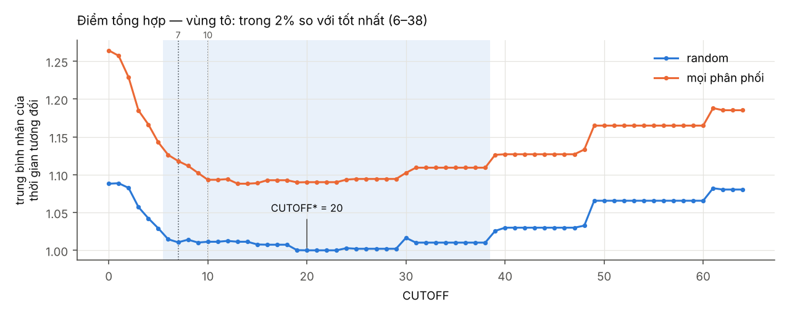
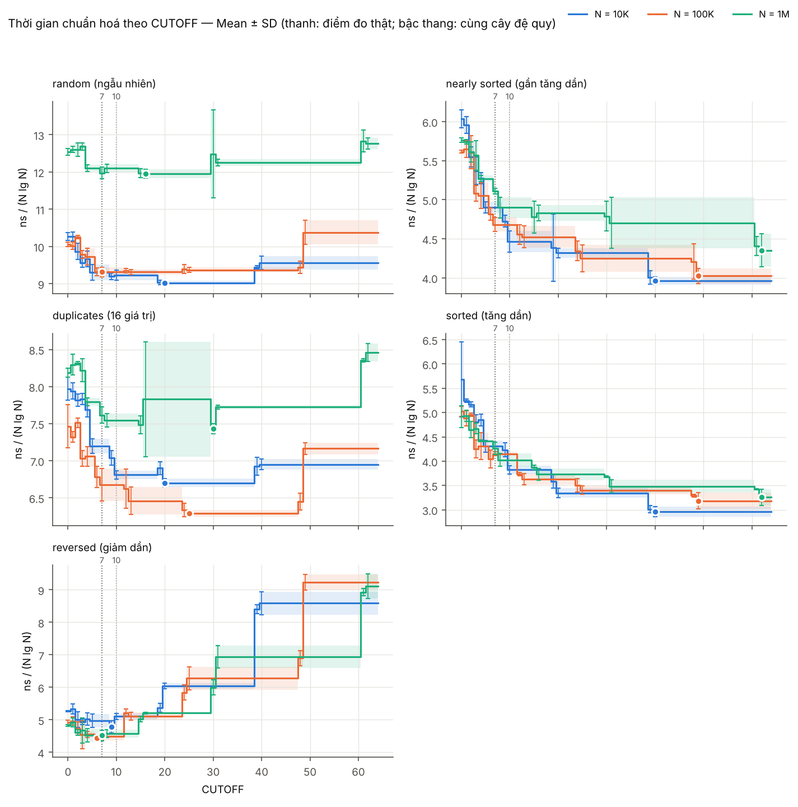
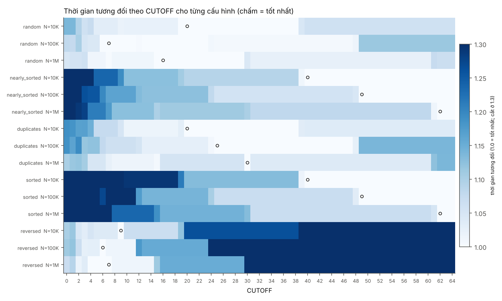
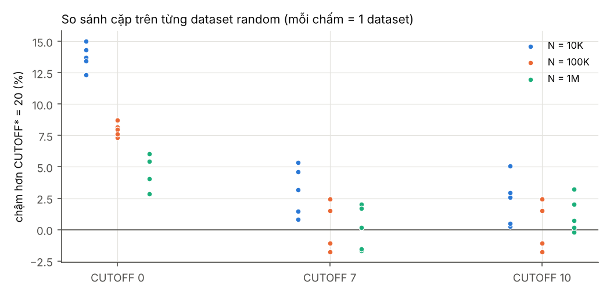
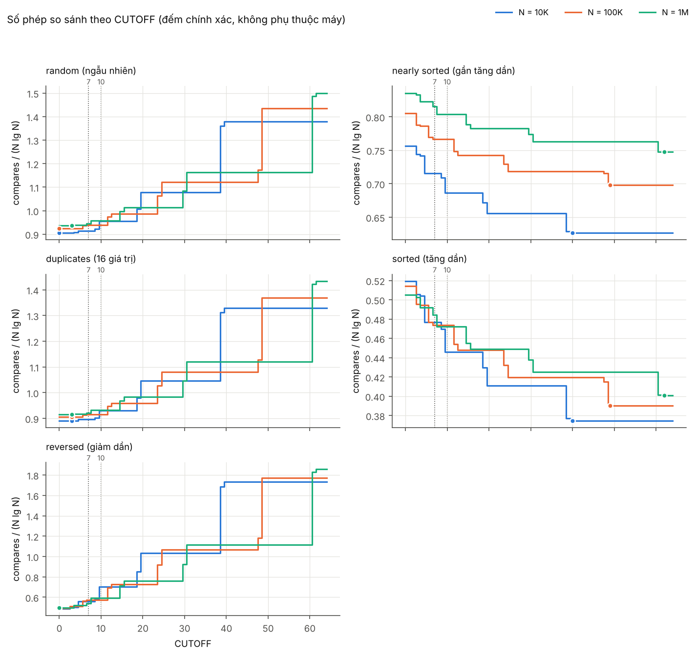
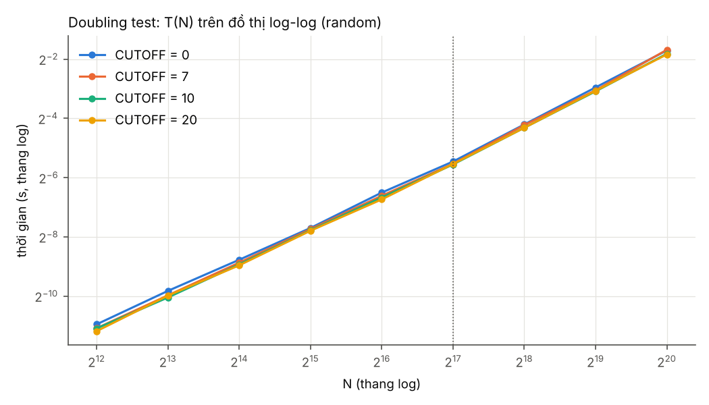

# Kết quả thí nghiệm CUTOFF cho MergeSort (tự sinh bởi scripts/analyze.py)

> Dùng bảng/hình ở đây cho phần *Kết quả*; phần *Phân tích* hãy tự viết từ số liệu này.

## 1. Môi trường và quy mô đo

| Mục | Giá trị |
|---|---|
| CPU | Intel64 Family 6 Model 141 Stepping 1, GenuineIntel |
| Số luồng logic | 12 |
| Hệ điều hành | Windows 11 10.0 amd64 |
| JDK | OpenJDK 64-Bit Server VM 25.0.1 (Microsoft) |
| Backend đo | jmh |
| Tham số JVM (fork) | -Xms2g -Xmx2g -XX:+UseParallelGC |
| SHA-256 MergeSort.class | 53f5e31b54fecf61… |
| Thời điểm | 2026-11-09T09:53:38.007496 |
| Lượt chạy | grid-20261109-095145 |

- 51 datasets × 65 CUTOFF (0–64); đo thật 646 cấu hình, các CUTOFF còn lại được suy ra từ lớp tương đương (cùng cây đệ quy).
- 43,860 lần sort được ghi nhận; warm-up/measurement/forks theo config.properties của lượt chạy.

## 2. CUTOFF khuyến nghị

- **CUTOFF\* = 20**: nhỏ nhất theo trung bình nhân thời gian tương đối trên các cấu hình **random** (mọi N).
- Vùng trong 2% so với tốt nhất: **6–38**.
- CUTOFF = 0: chậm hơn CUTOFF\* **+8.8%** (trung bình nhân).
- CUTOFF = 7: chậm hơn CUTOFF\* **+1.1%** (trung bình nhân).
- CUTOFF = 10: chậm hơn CUTOFF\* **+1.1%** (trung bình nhân).
- Tính trên mọi phân phối, tốt nhất là CUTOFF = 13. Các phân phối có thể kéo theo hướng khác nhau (dữ liệu gần sắp xếp thường ưa CUTOFF lớn, dữ liệu giảm dần thường ưa CUTOFF nhỏ).

## 3. Theo từng (phân phối, N)

`lớp tốt nhất` = các CUTOFF cho cùng cây đệ quy với CUTOFF tốt nhất (không phân biệt được bằng đo). `bootstrap 95%` = khoảng chứa argmin khi lấy mẫu lại dataset và fork. `rel_X` = thời gian của CUTOFF X / tốt nhất.

| dist | N | k | lớp tốt nhất | vùng ≤2% | bootstrap 95% | rel_0 | rel_7 | rel_10 | t tốt nhất (ms) | SD (ms) | SD giữa |
|---|---|---|---|---|---|---|---|---|---|---|---|
| random | 10K | 5 | 20–38 | 9–38 | 19–20 | 1.138 | 1.031 | 1.022 | 1.199 | 0.006 | datasets |
| random | 100K | 5 | 7–11 | 6–48 | 6–25 | 1.080 | 1.000 | 1.000 | 15.468 | 0.206 | datasets |
| random | 1M | 5 | 16–29 | 4–29 | 7–30 | 1.049 | 1.001 | 1.012 | 238.356 | 2.406 | datasets |
| nearly_sorted | 10K | 5 | 40–64 | 39–64 | 39–40 | 1.523 | 1.237 | 1.126 | 0.526 | 0.007 | datasets |
| nearly_sorted | 100K | 5 | 49–64 | 49–64 | 25–49 | 1.395 | 1.164 | 1.164 | 6.684 | 0.162 | datasets |
| nearly_sorted | 1M | 5 | 62–64 | 61–64 | 61–62 | 1.324 | 1.175 | 1.126 | 86.753 | 4.225 | datasets |
| duplicates | 10K | 5 | 20–38 | 10–38 | 20–20 | 1.190 | 1.074 | 1.016 | 0.890 | 0.008 | datasets |
| duplicates | 100K | 5 | 25–47 | 24–47 | 13–25 | 1.187 | 1.061 | 1.061 | 10.449 | 0.071 | datasets |
| duplicates | 1M | 5 | 30–30 | 8–30 | 15–30 | 1.101 | 1.024 | 1.015 | 148.179 | 1.372 | datasets |
| sorted | 10K | 1 | 40–64 | 39–64 | 39–40 | 1.921 | 1.455 | 1.292 | 0.393 | 0.014 | forks |
| sorted | 100K | 1 | 49–64 | 49–64 | 48–49 | 1.578 | 1.305 | 1.305 | 5.286 | 0.275 | forks |
| sorted | 1M | 1 | 62–64 | 62–64 | 31–62 | 1.510 | 1.310 | 1.236 | 64.919 | 3.336 | forks |
| reversed | 10K | 1 | 9–9 | 9–9 | 3–9 | 1.101 | 1.039 | 1.067 | 0.636 | 0.025 | forks |
| reversed | 100K | 1 | 6–6 | 6–11 | 3–7 | 1.111 | 1.013 | 1.013 | 7.360 | 0.133 | forks |
| reversed | 1M | 1 | 7–7 | 2–14 | 3–7 | 1.069 | 1.000 | 1.013 | 90.077 | 3.260 | forks |

## 4. So sánh cặp với CUTOFF\* (đơn vị = dataset)

Mỗi dataset cho một tỉ số t(CUTOFF)/t(CUTOFF\*) từ dataset means (đã gộp fork). Tỉ lệ > 1 nghĩa là chậm hơn. CI95 và p (t) dùng phân phối t trên log tỉ số (cần ≥ 3 dataset); Wilcoxon chỉ tính khi có ≥ 6 dataset.

| nhóm | so_sánh | datasets | tỉ lệ TB nhân | CI95 thấp | CI95 cao | chậm hơn ở | p (t, log) | p (Wilcoxon) |
|---|---|---|---|---|---|---|---|---|
| random | 0 vs 20 | 15 | 1.088 | 1.067 | 1.11 | 15/15 | 2.998e-07 | 6.104e-05 |
| random | 7 vs 20 | 15 | 1.01 | 0.9981 | 1.023 | 10/15 | 0.09106 | 0.1354 |
| random | 10 vs 20 | 15 | 1.011 | 1.001 | 1.022 | 11/15 | 0.03545 | 0.04126 |
| nearly_sorted | 0 vs 20 | 15 | 1.274 | 1.223 | 1.327 | 15/15 | 4.493e-09 | 6.104e-05 |
| nearly_sorted | 7 vs 20 | 15 | 1.075 | 1.048 | 1.103 | 14/15 | 3.1e-05 | 0.0001221 |
| nearly_sorted | 10 vs 20 | 15 | 1.027 | 1.008 | 1.047 | 11/15 | 0.01003 | 0.01508 |
| duplicates | 0 vs 20 | 15 | 1.13 | 1.082 | 1.18 | 14/15 | 2.889e-05 | 0.0008545 |
| duplicates | 7 vs 20 | 15 | 1.027 | 0.986 | 1.07 | 12/15 | 0.1819 | 0.03015 |
| duplicates | 10 vs 20 | 15 | 1.005 | 0.9693 | 1.042 | 11/15 | 0.7632 | 0.1205 |
| sorted | 0 vs 20 | 3 | 1.458 | 1.044 | 2.036 | 3/3 | 0.03994 | – |
| sorted | 7 vs 20 | 3 | 1.19 | 1.004 | 1.409 | 3/3 | 0.04775 | – |
| sorted | 10 vs 20 | 3 | 1.122 | 1.033 | 1.217 | 3/3 | 0.02655 | – |
| reversed | 0 vs 20 | 3 | 0.9202 | 0.813 | 1.041 | 0/3 | 0.1017 | – |
| reversed | 7 vs 20 | 3 | 0.856 | 0.7853 | 0.9331 | 0/3 | 0.01622 | – |
| reversed | 10 vs 20 | 3 | 0.8673 | 0.8194 | 0.918 | 0/3 | 0.008489 | – |
| TẤT CẢ | 0 vs 20 | 51 | 1.161 | 1.122 | 1.201 | 47/51 | 1.175e-11 | 1.14e-08 |
| TẤT CẢ | 7 vs 20 | 51 | 1.034 | 1.011 | 1.058 | 39/51 | 0.004652 | 0.0002759 |
| TẤT CẢ | 10 vs 20 | 51 | 1.011 | 0.9937 | 1.029 | 36/51 | 0.2072 | 0.005371 |

## 5. Kiểm tra nhiễu: CUTOFF 0 và 1

Theo hợp đồng cài đặt, CUTOFF 1 làm cùng công việc với 0, nên t(1)/t(0) lý tưởng = 1. Trên 51 dataset: trung vị 0.9982, nhỏ nhất 0.9061, lớn nhất 1.0368. Độ lệch này là mức nhiễu đo: chênh lệch giữa các CUTOFF nhỏ hơn mức này không nên được diễn giải.

## 6. Lớp tương đương và kích thước lá (hiện tượng bậc thang)

Top-down mergesort chỉ tạo các đoạn con dài ≈ N/2^k, nên nhiều CUTOFF liên tiếp cho **cùng** một cây đệ quy. Các lớp dưới đây được tính chính xác từ cây và đã được kiểm chứng trên cài đặt của bạn bằng chuỗi phép so sánh.

- N = 10K: 0, 1, 2, 3, 4, 5–8, 9, 10–18, 19, 20–38, 39, 40–64
- N = 100K: 0, 1, 2, 3, 4–5, 6, 7–11, 12, 13–23, 24, 25–47, 48, 49–64
- N = 1M: 0, 1, 2, 3, 4–6, 7, 8–14, 15, 16–29, 30, 31–60, 61, 62–64

| CUTOFF | lá TB, N=10K | lá TB, N=100K | lá TB, N=1M |
|---|---|---|---|
| 1 | 1.0 | 1.0 | 1.0 |
| 4 | 2.6 | 3.1 | 3.8 |
| 7 | 4.9 | 6.1 | 4.7 |
| 8 | 4.9 | 6.1 | 7.6 |
| 10 | 9.8 | 6.1 | 7.6 |
| 12 | 9.8 | 10.1 | 7.6 |
| 15 | 9.8 | 12.2 | 12.1 |
| 16 | 9.8 | 12.2 | 15.3 |
| 20 | 19.5 | 12.2 | 15.3 |
| 24 | 19.5 | 17.3 | 15.3 |
| 31 | 19.5 | 24.4 | 30.5 |
| 32 | 19.5 | 24.4 | 30.5 |
| 48 | 39.1 | 26.7 | 30.5 |
| 64 | 39.1 | 48.8 | 61.0 |

## 7. Số phép so sánh (không phụ thuộc máy)

Random, N = 1M. Số so sánh nhỏ nhất ở CUTOFF = 3, trong khi thời gian nhỏ nhất ở CUTOFF\* = 20: một bước insertion sort rẻ hơn một bước merge (không copy sang aux, không đệ quy).

| CUTOFF | compares | so với CUTOFF 0 |
|---|---|---|
| 0 | 18674665 | 1.000 |
| 4 | 18728225 | 1.003 |
| 7 | 18823152 | 1.008 |
| 10 | 19073468 | 1.021 |
| 16 | 20223474 | 1.083 |
| 20 | 20223474 | 1.083 |
| 24 | 20223474 | 1.083 |
| 32 | 23184462 | 1.241 |
| 48 | 23184462 | 1.241 |
| 64 | 29898689 | 1.601 |

## Doubling test (random)

Cột *lý thuyết N lg N* là tỉ số T(2N)/T(N) mà mô hình c·N lg N dự đoán: 2·(1 + 1/lg N).

| CUTOFF | N | T (ms) | T(2N)/T(N) | lý thuyết N lg N |
|---|---|---|---|---|
| 0 | 4,096 | 0.5037 | – | – |
| 0 | 8,192 | 1.102 | 2.187 | 2.167 |
| 0 | 16,384 | 2.281 | 2.071 | 2.154 |
| 0 | 32,768 | 4.8 | 2.104 | 2.143 |
| 0 | 65,536 | 10.99 | 2.29 | 2.133 |
| 0 | 131,072 | 22.72 | 2.067 | 2.125 |
| 0 | 262,144 | 54.14 | 2.383 | 2.118 |
| 0 | 524,288 | 128.7 | 2.377 | 2.111 |
| 0 | 1,048,576 | 305.9 | 2.377 | 2.105 |
| 7 | 4,096 | 0.4598 | – | – |
| 7 | 8,192 | 0.9921 | 2.158 | 2.167 |
| 7 | 16,384 | 2.133 | 2.15 | 2.154 |
| 7 | 32,768 | 4.677 | 2.193 | 2.143 |
| 7 | 65,536 | 10.2 | 2.181 | 2.133 |
| 7 | 131,072 | 21.55 | 2.113 | 2.125 |
| 7 | 262,144 | 53.38 | 2.477 | 2.118 |
| 7 | 524,288 | 120.3 | 2.254 | 2.111 |
| 7 | 1,048,576 | 310.6 | 2.581 | 2.105 |
| 10 | 4,096 | 0.4575 | – | – |
| 10 | 8,192 | 0.944 | 2.063 | 2.167 |
| 10 | 16,384 | 2.047 | 2.169 | 2.154 |
| 10 | 32,768 | 4.549 | 2.222 | 2.143 |
| 10 | 65,536 | 9.802 | 2.155 | 2.133 |
| 10 | 131,072 | 21.22 | 2.165 | 2.125 |
| 10 | 262,144 | 50.09 | 2.36 | 2.118 |
| 10 | 524,288 | 117.4 | 2.344 | 2.111 |
| 10 | 1,048,576 | 283.1 | 2.411 | 2.105 |
| 20 | 4,096 | 0.4293 | – | – |
| 20 | 8,192 | 0.9862 | 2.298 | 2.167 |
| 20 | 16,384 | 2.003 | 2.031 | 2.154 |
| 20 | 32,768 | 4.499 | 2.246 | 2.143 |
| 20 | 65,536 | 9.365 | 2.082 | 2.133 |
| 20 | 131,072 | 21.47 | 2.293 | 2.125 |
| 20 | 262,144 | 50.01 | 2.329 | 2.118 |
| 20 | 524,288 | 119 | 2.379 | 2.111 |
| 20 | 1,048,576 | 278.6 | 2.341 | 2.105 |

Mô hình luỹ thừa T(N) ≈ a·N^b khớp riêng trên hai khoảng, tách tại N = 131,072 (bỏ điểm N nhỏ nhất). *b lý thuyết* là độ dốc log-log của N lg N trên cùng khoảng: b đo xấp xỉ b lý thuyết nghĩa là khớp N lg N; b đo lớn hơn rõ rệt ở **mọi** CUTOFF cho thấy ảnh hưởng của hệ thống bộ nhớ, không phải của cutoff. CUTOFF chủ yếu đổi hằng số a.

| CUTOFF | khoảng N | điểm | b đo | b lý thuyết (N lg N) | a (s) |
|---|---|---|---|---|---|
| 0 | 8,192–131,072 | 5 | 1.1 | 1.097 | 5.348e-08 |
| 0 | 131,072–1,048,576 | 4 | 1.25 | 1.078 | 9.098e-09 |
| 7 | 8,192–131,072 | 5 | 1.114 | 1.097 | 4.34e-08 |
| 7 | 131,072–1,048,576 | 4 | 1.272 | 1.078 | 6.669e-09 |
| 10 | 8,192–131,072 | 5 | 1.124 | 1.097 | 3.774e-08 |
| 10 | 131,072–1,048,576 | 4 | 1.244 | 1.078 | 9.071e-09 |
| 20 | 8,192–131,072 | 5 | 1.111 | 1.097 | 4.286e-08 |
| 20 | 131,072–1,048,576 | 4 | 1.234 | 1.078 | 1.032e-08 |

