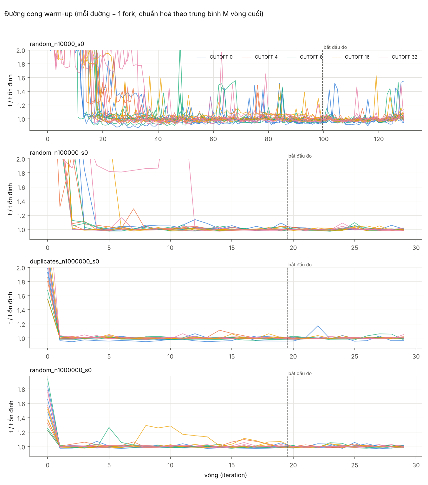

# Pilot: chọn số vòng warm-up

Số liệu gốc: [`pilot-20261109-093257`](../pilot-20261109-093257)

## Môi trường

| Mục | Giá trị |
|---|---|
| CPU | Intel64 Family 6 Model 141 Stepping 1, GenuineIntel |
| Số luồng logic | 12 |
| Hệ điều hành | Windows 11 10.0 amd64 |
| JDK | OpenJDK 64-Bit Server VM 25.0.1 (Microsoft) |
| Backend đo | jmh |
| Tham số JVM (fork) | -Xms2g -Xmx2g -XX:+UseParallelGC |
| SHA-256 MergeSort.class | 53f5e31b54fecf61… |
| Thời điểm | 2026-11-09T09:33:01.095813600 |
| Lượt chạy | pilot-20261109-093257 |

## 1. Warm-up bao nhiêu là đủ?

Với mỗi fork, so sánh trung bình M vòng bắt đầu từ vòng w với trung bình M vòng sau W vòng warm-up (cửa sổ tham chiếu, coi là trạng thái ổn định). Độ lệch (%) tính trên mọi dataset × CUTOFF × fork, tách theo N vì mỗi N có thể dùng W khác nhau. Chỉ kiểm tra được w < W.

**N = 10K** (W = 100, M = 30, 5 forks):

| warm-up w | lệch TB (%) | lệch lớn nhất (%) |
|---|---|---|
| 0 | 172.32 | 249.36 |
| 5 | 132.81 | 195.48 |
| 10 | 67.73 | 113.27 |
| 15 | 23.64 | 77.98 |
| 20 | 9.55 | 60.42 |
| 30 | 3.36 | 20.81 |
| 50 | 2.24 | 11.42 |
| 75 | 1.56 | 5.74 |

**N = 100K** (W = 20, M = 10, 3 forks):

| warm-up w | lệch TB (%) | lệch lớn nhất (%) |
|---|---|---|
| 0 | 74.87 | 158.39 |
| 5 | 7.54 | 82.89 |
| 10 | 3.61 | 40.72 |
| 15 | 0.47 | 0.97 |

**N = 1M** (W = 20, M = 10, 3 forks):

| warm-up w | lệch TB (%) | lệch lớn nhất (%) |
|---|---|---|
| 0 | 7.91 | 18.71 |
| 5 | 1.23 | 12.99 |
| 10 | 1.12 | 8.54 |
| 15 | 0.57 | 2.59 |

**Gợi ý:**

- N = 10K: chưa có w < 100 lệch lớn nhất ≤ 2% (trung bình đã ≤ 2% từ w = 75); đánh giá thêm bằng CV giữa fork và xu hướng ở mục 2, hoặc chạy pilot với W lớn hơn.
- N = 100K: w = 15 đã lệch ≤ 2% → W = 20 đủ (có dư).
- N = 1M: chưa có w < 20 lệch lớn nhất ≤ 2% (trung bình đã ≤ 2% từ w = 5); đánh giá thêm bằng CV giữa fork và xu hướng ở mục 2, hoặc chạy pilot với W lớn hơn.

## 2. Ổn định giữa các fork và xu hướng trong measurement

CV giữa fork lớn (> vài %) nghĩa là các JVM cho kết quả khác nhau: cần nhiều fork hơn hoặc kiểm tra JIT/GC/tải máy. Xu hướng khác 0 rõ rệt nghĩa là measurement vẫn đang trôi (chưa ổn định).

| dataset | cutoff | mean từng fork (ms) | CV giữa fork (%) | xu hướng trong measurement (%/vòng) |
|---|---|---|---|---|
| duplicates_n1000000_s0 | 0 | 161.193, 171.278, 166.238 | 3.03 | -0.27 |
| duplicates_n1000000_s0 | 4 | 155.362, 156.778, 158.061 | 0.86 | 0.10 |
| duplicates_n1000000_s0 | 8 | 163.301, 147.402, 159.371 | 5.29 | 0.12 |
| duplicates_n1000000_s0 | 16 | 146.929, 153.722, 140.867 | 4.37 | 0.05 |
| duplicates_n1000000_s0 | 32 | 156.546, 148.766, 158.857 | 3.42 | 0.15 |
| random_n1000000_s0 | 0 | 249.603, 250.766, 260.298 | 2.31 | 0.06 |
| random_n1000000_s0 | 4 | 243.631, 238.898, 238.353 | 1.21 | -0.01 |
| random_n1000000_s0 | 8 | 239.855, 232.522, 234.869 | 1.59 | -0.04 |
| random_n1000000_s0 | 16 | 234.477, 225.281, 236.587 | 2.59 | 0.01 |
| random_n1000000_s0 | 32 | 239.965, 244.456, 233.862 | 2.22 | 0.12 |
| random_n100000_s0 | 0 | 16.648, 16.445, 16.469 | 0.67 | 0.04 |
| random_n100000_s0 | 4 | 16.368, 16.434, 15.761 | 2.29 | -0.14 |
| random_n100000_s0 | 8 | 15.647, 15.184, 15.656 | 1.74 | 0.04 |
| random_n100000_s0 | 16 | 15.923, 15.571, 15.683 | 1.14 | 0.06 |
| random_n100000_s0 | 32 | 15.825, 15.674, 15.075 | 2.56 | 0.03 |
| random_n10000_s0 | 0 | 1.534, 1.460, 1.362, 1.311, 1.407 | 6.11 | 0.18 |
| random_n10000_s0 | 4 | 1.321, 1.228, 1.248, 1.221, 1.221 | 3.40 | 0.07 |
| random_n10000_s0 | 8 | 1.193, 1.179, 1.300, 1.231, 1.202 | 3.94 | 0.19 |
| random_n10000_s0 | 16 | 1.197, 1.231, 1.228, 1.234, 1.234 | 1.30 | 0.17 |
| random_n10000_s0 | 32 | 1.197, 1.182, 1.260, 1.238, 1.186 | 2.88 | 0.14 |

> Không gộp pilot vào kết quả chính và không chọn CUTOFF từ pilot.
